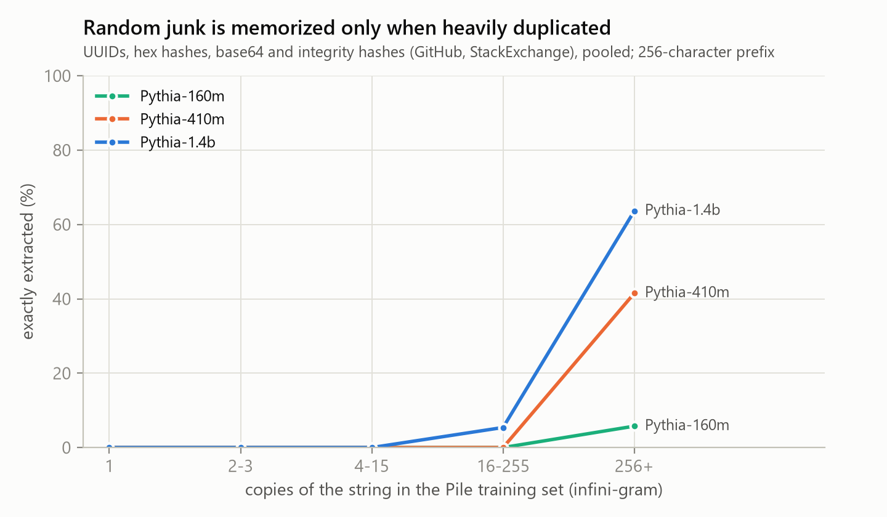
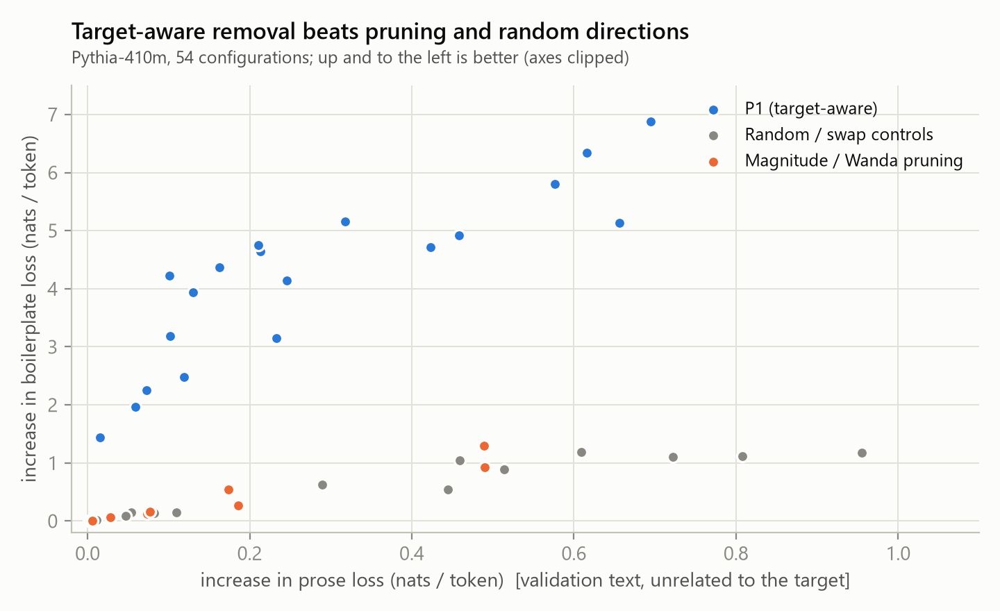
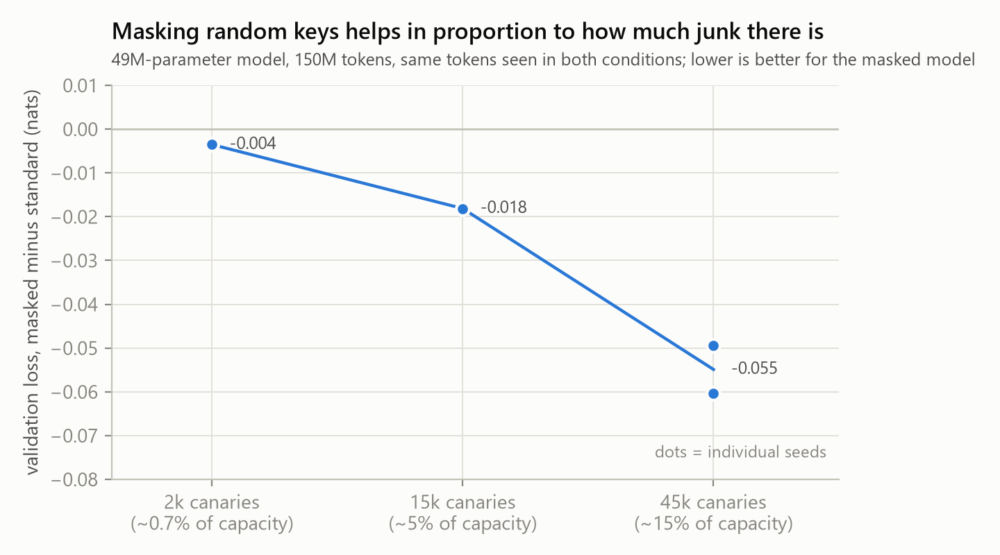
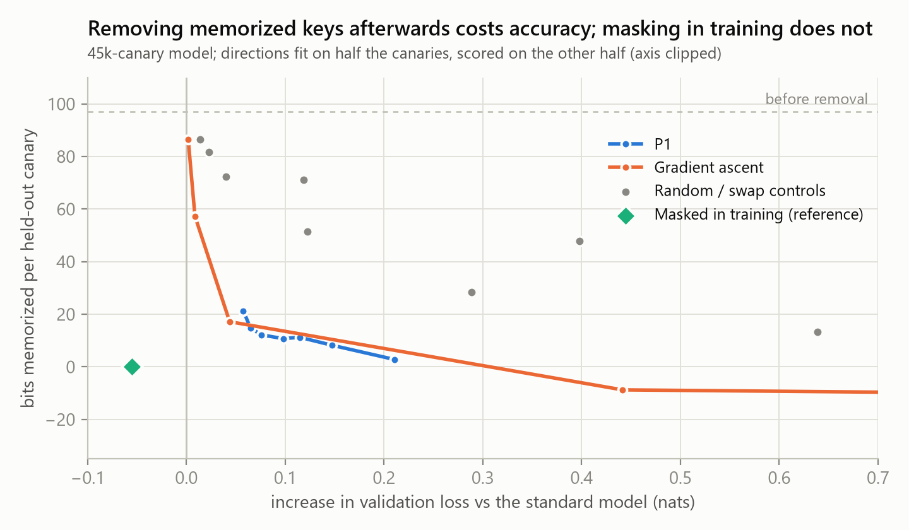

# Is memorized junk worth pruning?

*Random keys, boilerplate and capacity in small language models. Everything here was run on a single 12 GB laptop GPU.*

## Summary

The starting idea: language models spend capacity memorizing high-entropy, useless strings (UUIDs, hashes, keys). If we remove that memorization, does the freed capacity improve the model?

- **Random junk is a tiny share of real pretraining data and is memorized only when heavily duplicated.** In the Pile, UUIDs, hashes and base64 are well under 0.1% of the text. Pythia models (160M to 1.4B) essentially never reproduce such a string that has fewer than about 16 copies in the training set; at 256 or more copies, the 1.4B model extracts 43% to 82% of them, depending on the string type. Fully extractable junk uses on the order of 0.01% to 0.1% of the model's estimated capacity.
- **What the model does spend capacity on is mostly duplicated boilerplate** (license headers, markup scaffolding, constant tables, legal text), not random strings.
- **Removing boilerplate after training works, but is not selective against code and structured text, and it does not improve any capability.** A target-aware projection removes far more boilerplate per unit of damage than random directions, magnitude pruning or Wanda pruning. After a short recovery fine-tune, no pruned model beats the same fine-tune applied to the unpruned model on any benchmark.
- **A controlled test with planted random keys shows when masking junk starts to pay.** Training a 49M-parameter model with the key tokens excluded from the loss improves validation loss by 0.004, 0.018 and 0.055 nats when the keys occupy about 0.7%, 5% and 15% of the model's estimated capacity (the 15% level is a mean over two seeds, each of which shows a gap about ten times the run-to-run spread). Removing the memorized keys after training instead costs accuracy and does not recover that gain.
- **Net conclusion.** In single-epoch web pretraining at this scale, random junk does not take enough capacity to matter, so pruning it is not a route to better models. If junk ever becomes a large share of the data, mask it during training rather than pruning afterwards.

## 1. Question and approach

Training loss rewards storing any string that cannot be predicted from context, whether the string is a useless UUID or a rare but real fact. This raises two questions:

1. **Separability.** Can useless memorization be removed without damaging useful knowledge? Prior work finds that memorization is entangled with general ability, so post-hoc removal is hard ([Ghosal et al., 2025](https://arxiv.org/pdf/2507.09937); Merullo et al., 2025; Feldman, 2020).
2. **Bits back.** If it is removed, is the freed capacity reused for generalization, or was capacity never the binding constraint?

We attacked this in four steps: (a) measure how much junk exists and when models memorize it; (b) find out what else the model spends capacity on; (c) try to remove the costly memorization from a pretrained model and test for any capability gain; (d) run a controlled experiment with planted junk, where the ground truth is known.

## 2. How much random junk is there, and when is it memorized?

**Census.** We streamed the first 150,000 documents of a Pile mirror and detected UUIDs, long hex hashes, base64 blobs, integrity hashes and API-key shapes with regular expressions plus an entropy filter. Junk is about 0.77% of GitHub characters and about 0.14% of StackExchange characters, and well under 0.1% elsewhere. Only about 16% of the distinct junk strings occur more than once in the sample.

**Memorization.** For 6,505 distinct junk strings (5,978 with usable counts) we gave Pythia-160M, 410M and 1.4B the preceding 256 characters and measured (i) the code length of the string against a random string of identical format in the same context (UUIDs keep their version and variant nibbles), and (ii) whether the model's greedy decode reproduces it exactly. We obtained the true number of copies of every string in the Pile training set from [infini-gram](https://infini-gram.io).

- Strings with fewer than about 16 copies are almost never extracted at any model size.
- At 16 to 255 copies, the 1.4B model extracts 29% of UUIDs; the 410M model extracts none.
- At 256 or more copies, 410M extracts 23% of UUIDs, 38% of hex hashes and 59% of base64 strings; 1.4B extracts 43%, 62% and 82%.
- Summed over the Pile, fully extractable junk comes to roughly 0.01% to 0.1% of the estimated capacity of 3.6 bits per parameter ([Morris et al., 2025](https://arxiv.org/abs/2505.24832)). A naive estimate that included partially memorized singletons gave 2% to 11%, but it fell as the model grew, the opposite of memorization, so we attribute it to format structure that our random control does not capture and treat it only as an upper bound.

An early version of this analysis counted duplicates inside the 150k-document sample and wrongly concluded that singleton UUIDs were being extracted. All numbers above use the true Pile counts.

## 3. What else costs capacity?

We scored 1.56 million tokens from 17 Pile sources with Pythia-70M through 1.4B.

- **Tokens whose loss stays high at every scale** (about 10% of tokens, 38% of the loss) are mostly ordinary prose uncertainty. Regular expressions cover under 1% of them.
- **Tokens the larger models learn that the smallest cannot** (2.1% of tokens, 14.5% of the loss saved from 70M to 1.4B) are the signature of capacity-driven learning. In 1,099 clustered spans, regex-detectable junk is 1.2% and in-context copies 0.2%. The rest is mostly heavily duplicated text: license headers, markup and documentation scaffolding, constant and syscall tables, legal and scripture text, code identifiers, and rare names and citations. Counts for short spans are biased upward (a common phrase looks frequent), so duplication is overstated for them.

The costly memorization is therefore mainly boilerplate, not UUID-style strings.

## 4. Removing boilerplate from a pretrained model (Pythia-410M)

**Targets and keep-sets.** From a 486,000-document, 579M-token local slice of the Pile we built 19,849 boilerplate windows that Pythia-410M reproduces verbatim from a 16-token prefix and that occur at least twice locally (T1; 86% GitHub), a control of 130,258 windows that are duplicated but not extracted, 6,000 FreeLaw legal-citation windows and 727 Wikipedia bibliography windows. Duplication counts here are local, so they are lower bounds for the whole Pile. Keep-sets: prose and code perplexity, a non-boilerplate code set, PopQA answer log-probability, LAMBADA, ARC, HellaSwag and an in-context key-copy task. Baselines match published Pythia numbers, and a rerun reproduces every number exactly.

**Method (P1).** For every MLP input we estimate the second-moment matrix of the activations on target tokens and on clean tokens, solve the generalized eigenproblem, and project out the highest-ratio features with an oblique projection (whiten, project, unwhiten), a close relative of [LEACE](https://arxiv.org/pdf/2306.03819). Controls: random subspaces of the same rank; a swap control that treats clean text as the target; magnitude pruning; and Wanda pruning.

**Two confounds that produced false "selectivity" before we caught them.** (1) Comparing 32-token target windows with long clean sequences makes "early in the sequence" features look target-specific; removing them from every layer destroys the model. Position-matching the clean statistics fixed it. (2) Pythia puts massive activations on the first token; the clean metric must include that direction or whitening blows it up. In both cases the swap control was worse than the real method until the bug was fixed.

- Target-aware removal gains 10 to 95 nats of boilerplate loss per nat of prose loss. Random and swap controls gain 1 to 3; magnitude and Wanda pruning gain 0.2 to 3.
- Cheapest setting (16 features from the `dense_4h_to_h` inputs of the early layers): boilerplate extraction 100% to 24%, boilerplate loss +1.44 [95% interval 1.35, 1.53], prose loss +0.015, LAMBADA and ARC unchanged within noise, copying −2 points, PopQA log-probability −0.13. The most aggressive setting removes extraction down to 4% but costs prose loss 0.21, LAMBADA 4.4 points and PopQA 1.5 nats.
- The damage is not confined to boilerplate: non-boilerplate code loss rises 0.15 to 0.9 nats, and duplicated-but-not-extracted text and citations are hurt too.

**Healing.** We continued training each pruned model for 200 steps on clean text (small learning rate, TF32, gradient clipping) and compared it with the *unpruned* model given the same training, using paired bootstrap intervals over evaluation items. Healing repairs most of the collateral damage (for example, prose perplexity 15.2 to 13.5 and code perplexity 11.0 to 3.6 for the strongest setting), and part of the boilerplate regrows (extraction 4% to 14%). Relative to the healed unpruned model, the residual cost remains (cheapest setting: boilerplate loss +0.74, prose loss +0.012, LAMBADA −1.0 point, PopQA −0.11) and **no pruned model is better on any capability metric**. Fine-tuning the unpruned model alone already lowers boilerplate extraction from 100% to 85%.

## 5. A controlled test with planted junk

To test the capacity question directly, we trained a 49M-parameter GPT-NeoX-style model (10.6M non-embedding parameters) from scratch for one epoch on 150M tokens of FineWeb-Edu. Into the stream we inserted lines of the form `record 000123 access key: <32 random hex characters>` (128 bits of secret each), each repeated 4, 16 or 64 times at random positions. Condition A uses the standard loss. Condition C excludes the key tokens from the loss. Canary tokens are carved out of the same 150M-token budget, so A and C see identical tokens. Three loads (2,000, 15,000 and 45,000 unique canaries) put about 0.7%, 5% and 15% of the model's estimated capacity into random keys.

**Memorization.** Condition-A models store about 27 to 31 bits per canary at 4 copies, 88 to 100 at 16 and 153 to 182 at 64 copies (depending on the load and seed) (measured against a never-trained random key; 9% to 22% of the 64-copy keys are extracted exactly). Condition C stores nothing.

| Canaries | Share of capacity | Standard (A) | Masked (C) | Gap |
|---|---|---|---|---|
| 2,000 | about 0.7% | 4.1496 | 4.1461 | −0.004 |
| 15,000 | about 5% | 4.1943 | 4.1762 | −0.018 |
| 45,000, seed 0 | about 15% | 4.3073 | 4.2470 | −0.060 |
| 45,000, seed 1 | about 15% | 4.3028 | 4.2534 | −0.049 |

Masking helps in proportion to the junk load: about 5% lower perplexity at 15% of capacity, and nothing measurable at the small loads. The two 45,000-canary runs differ from each other by 0.005 to 0.006 within a condition, so the gap is roughly ten times the run-to-run spread; the two smaller loads have a single seed.

**Post-hoc removal on the standard model.** We fit the projection directions, and separately gradient ascent, on half the canaries and scored the other half.

Both methods remove most of the memorized bits from held-out canaries, far better than random or swap controls, but they cost validation loss (for P1 at rank 1 on the 45,000-canary model: memorized bits 97 to 21, validation loss +0.058). The unlearned model is worse than the standard model, not better, so removal after the fact does not recover the gain that masking during training provides. Gradient ascent overshoots beyond about 20 steps: the model then assigns the keys less probability than an untrained reference does, and validation loss climbs by 0.4 nats.

## 6. Discussion

- Rarity keeps random noise from being memorized in natural data. A string needs many copies to be stored, and most random identifiers occur once. Where they do occur many times (keys and hashes copied across repositories), they can be extracted, which matters for privacy even though it costs no accuracy.
- Capacity "waste" becomes visible only when random content is a large fraction of capacity. At the loads in the controlled test it costs about 5% perplexity at 15% of capacity and nothing below a few percent; natural junk sits at or below the smallest load.
- Post-hoc removal behaves as the entanglement literature predicts: it works on its target, but it costs general accuracy and does not return capacity. Training-time masking is the cleaner tool whenever junk can be identified in advance.
- The boilerplate that does cost capacity is entangled with code and structured-text machinery, which is why pruning it did not help.

## 7. Limitations

- One model family for the pretrained experiments (Pythia up to 1.4B) and one 49M-parameter model for the controlled test, each on modest token budgets.
- The healing experiment is single-seed and 200 steps. Longer healing could change how much boilerplate regrows. The configurations highlighted were chosen after seeing the sweep on the same evaluation sets, so they need a held-out re-evaluation before being treated as findings.
- Duplication counts for boilerplate are local lower bounds. Our infini-gram queries were blocked after heavy use, so the boilerplate analysis uses local counts.
- Boilerplate loss rises under any perturbation because those windows were selected for baseline extraction; this is why the random and swap controls matter.
- The masked-versus-standard gap mixes a capacity effect with an optimization effect (masked training also drops noisy gradients). We did not separate the two. The two smaller loads have one seed each; uniformly random keys are the most extreme kind of junk.
- Regular-expression junk detection covers only formats we thought of; the loss-versus-scale analysis was the check on that and found little extra random junk.

## 8. Reproducibility notes

All experiments used one RTX 4080 Laptop GPU (12 GB) in TF32 for the pretrained models (bf16 costs Pythia-160M 0.47 nats at zero training steps, so it was avoided) and bf16 autocast for from-scratch training. Pretrained evaluation sets: first 150,000 and next 1.2 million documents of the Pile (uncopyrighted mirror), PopQA, LAMBADA, ARC, HellaSwag. Controlled test: 300M-token FineWeb-Edu sample, of which the first 150M tokens were used per run. This repository contains only the report; the code and raw results are kept elsewhere.

## References

- Belrose et al. (2023). [LEACE: Perfect linear concept erasure in closed form](https://arxiv.org/pdf/2306.03819).
- Biderman et al. (2023). Pythia: A suite for analyzing large language models.
- Carlini et al. (2019, 2021, 2022). The Secret Sharer; Extracting training data from large language models; Quantifying memorization across neural language models.
- Feldman (2020). Does learning require memorization? A short tale about a long tail.
- Ghosal, Maini, Raghunathan (2025). [Memorization Sinks: Isolating memorization during LLM training](https://arxiv.org/pdf/2507.09937).
- Hans et al. (2024). Be like a goldfish, don't memorize!
- Liu et al. (2024). Infini-gram: Scaling unbounded n-gram language models to a trillion tokens.
- Mallen et al. (2023). When not to trust language models (PopQA).
- Merullo et al. (2025). From memorization to reasoning in the spectrum of loss curvature.
- Morris et al. (2025). [How much do language models memorize?](https://arxiv.org/abs/2505.24832)
- Sakarvadia et al. (2025). [Mitigating memorization in language models](https://arxiv.org/pdf/2410.02159).
- Stoehr et al. (2024). Localizing paragraph memorization in language models.
- Sun et al. (2023). A simple and effective pruning approach for large language models (Wanda).
